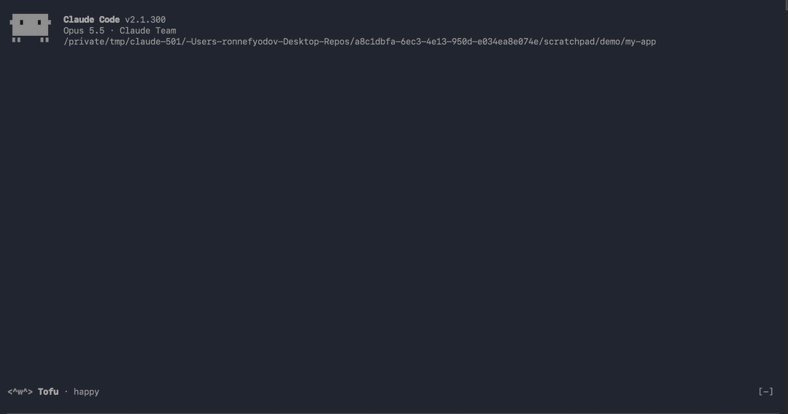

# Wrapped

Your Claude Code year in one shareable card.

## Why

You spend hours a day with Claude Code. Wrapped shows you what that looks
like: how much you ask, which tools do the work, which file you never stop
editing, and when you code best.

- **One card.** Every number on one screen, for this month, this year or all time.
- **Shareable.** `/wrapped export` saves a 1200×630 SVG, ready for a post.
- **Fun.** A title like *The Refactorer* and a persona like *Night owl*.
- **Private.** Stats are counted on your machine. Nothing leaves it.

## Use

| Command | What |
|---------|------|
| `/wrapped` | This year's card: prompts, turns, tokens, tool calls, active days, streak, top tools, peak hour, most edited file |
| `/wrapped month` / `/wrapped all` | Other ranges |
| `/wrapped export` | Writes `claude-wrapped-<year>.svg` (1200×630) to the current folder — share it |
| `/wrapped reset` | Clears stats (asks you to confirm) |

You also get a title (The Refactorer, The Explorer, The Operator, …) and a
persona from your peak hour (Early bird, Night owl, …).

All stats stay on your machine, in the mod's local store.

## Install

    /plugin marketplace add Ron-Nefyodov/wrapped-mod
    /plugin install wrapped@wrapped

Or try it locally: `claude --plugin-dir .`

## Develop

    npm test            # claude plugin test .
    claude plugin validate .
